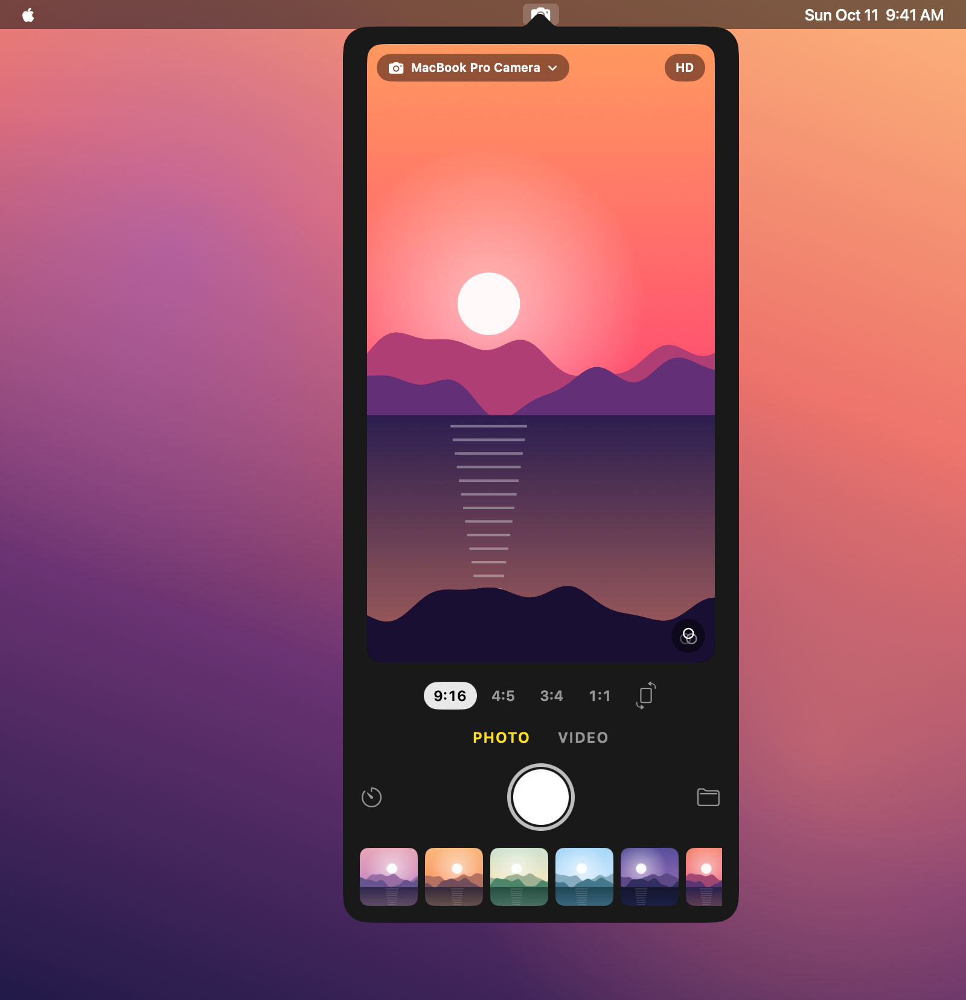
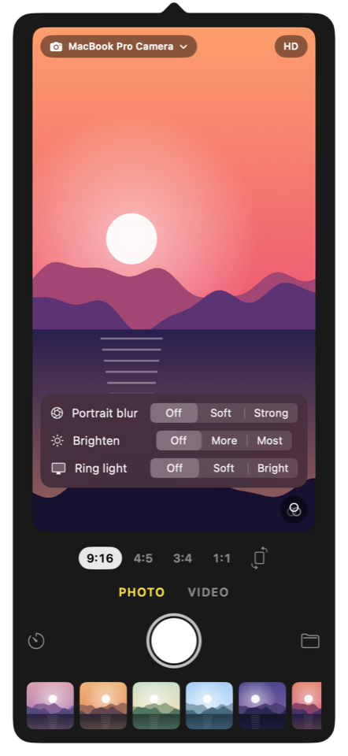
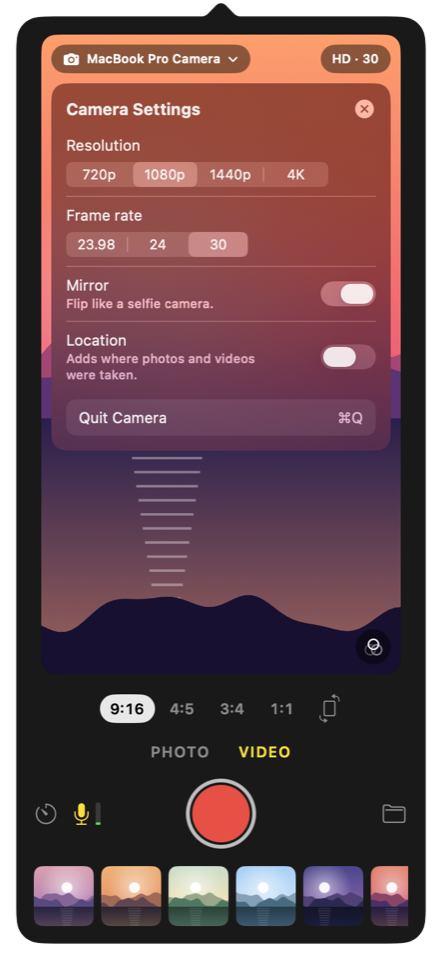
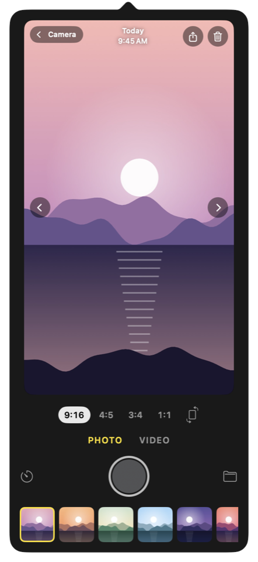

# Camera

[](https://github.com/muqsitnawaz/camera/releases/latest)
[](LICENSE)
[](LICENSE)
[](#requirements)
[](#requirements)

The camera app macOS never shipped. It lives in your menu bar: click the icon for a live
preview, then take a photo or record a video in 9:16, 4:5, 3:4 or 1:1, at 720p to 4K and 23.98,
24, 30 or 60 fps.

<p align="center"></p>

Download the latest signed and notarized app from
[Releases](https://github.com/muqsitnawaz/camera/releases/latest), unzip it and move it to
Applications. Formerly BetterBooth: version 0.4 keeps your permissions, camera and format
choices, and moves your captures from `~/Pictures/BetterBooth` to `~/Pictures/Camera`. Effects
and the ring light start off.

## A tour

<table>
<tr>
<td align="center" width="33%"><br><b>Effects</b> sit over the picture, so you see each change as you make it</td>
<td align="center" width="33%"><br><b>Camera Settings</b> open from the HD badge: resolution, frame rate, mirror, location</td>
<td align="center" width="33%"><br><b>Your captures</b> open in place, like Photos: the date, Share and Delete</td>
</tr>
</table>

[**Try the interactive design prototype**](https://muqsitnawaz.github.io/camera/design/): every
control in its popover is clickable.

- **Camera.** The camera's name sits on the preview; click it to pick any connected camera.
- **Photo or Video.** The microphone and its level meter appear in Video only. Click the mic to
  mute; right-click it to pick a microphone.
- **Orientation.** The rotate button (or R) turns the frame on its side: 9:16 becomes 16:9, 4:5
  becomes 5:4.
- **A camera mounted sideways.** The first time a camera sees a face, Camera turns its picture
  upright on its own. The turn button at the preview's corner turns it a further 90°; right-click
  it to pick one. The turn is remembered per camera, whichever USB port it is plugged into.
- **Effects.** The button at the preview's corner opens Portrait blur, Brighten, and the ring
  light: a band of white light around the edge of your screen that lights your face. Right-click
  the ring light to pick which displays it shines from.
- **Camera Settings.** The badge on the preview shows the format (HD, 4K, and the frame rate in
  Video) and opens its settings. Rates a camera can't deliver aren't offered, and a size above the
  camera's real pixels says it is upscaled. Location writes where a capture was taken into the
  file, and is off until you turn it on. Quit is here too.
- **Timer.** Click for a countdown; right-click for 3 or 10 seconds.
- **Viewing.** Click a capture in the strip to see it in place; double-click to open it in Preview
  or QuickTime. The shutter takes you back to the camera.
- **Searchable files.** Captures go to `~/Pictures/Camera`, named with the camera, aspect,
  resolution and frame rate: `Camera 2026-10-11 01.18.09 cam-link-4k 9x16 1080p 30fps.mp4`.
  The folder button opens it.

Video is H.264 with AAC sound in an `.mp4`; photos are JPEG. Drag the popover off the menu bar to
keep it open as a window.

## Works with

- **Your iPhone, wirelessly.** With Continuity Camera, your iPhone shows up as a camera: shoot
  vertical photos and video on the iPhone's camera while working on your Mac.
- **The MacBook camera, vertical for real.** 9:16 uses the camera's native 1080×1920 mode
  instead of cutting a strip out of a landscape frame.
- **Capture cards.** An HDMI capture card such as the Elgato Cam Link 4K turns a mirrorless or
  DSLR camera into a source, at up to 60 fps.
- **USB webcams and audio interfaces.** Any camera and any microphone macOS sees.
- **A camera mounted on its side.** Camera turns its picture upright from the first face it sees,
  so the full sensor becomes a vertical frame; it remembers the turn for that camera.
- **A closed MacBook lid.** The built-in camera is off, so Camera uses another connected
  camera and switches back to your choice when it returns.

## For AI agents

Camera captures from the command line without a window, which makes it a camera an agent
can call: one command, the saved file's path on stdout, a reason and exit code 1 on failure.
[`skills/camera/SKILL.md`](skills/camera/SKILL.md) is a ready-made skill to give your
agent; copy the folder into your agent's skills directory (for Claude Code,
`~/.claude/skills/`). Agents changing the code start at [`AGENTS.md`](AGENTS.md).

## Requirements

- macOS 14 or later, Apple silicon or Intel
- Xcode or the Command Line Tools (`xcode-select --install`), for Swift 5.9 or later

## Build and install

```sh
./scripts/install.sh   # build, sign, copy to /Applications and launch
./scripts/build.sh     # only build build/Camera.app
./scripts/release.sh notes.md   # notarize and publish the Info.plist version on GitHub
```

`swift run` works for a quick try, but the bare binary borrows your terminal's camera and
microphone permission. The scripts build a real app with its own permissions and icon.

The build is signed with your Developer ID if your keychain has one. Without one it is signed ad
hoc, which runs the same, but macOS asks for camera permission again after each rebuild.

## Permissions

Camera asks for the camera the first time you open it, for the microphone the first time you
switch to Video with sound on, and for your location the first time you turn on Location. While
the popover is open in Video with sound on, the microphone is live for the level meter, so macOS
shows its microphone indicator. Photo never opens it. If you said no, turn it back on in
System Settings → Privacy & Security → Camera (or Microphone). Without microphone access, videos record without sound and Camera says
so.

A MacBook's own camera is off while its lid is closed. Camera then uses another connected
camera, and tells you if you pick the built-in one.

## Scripted capture

With no window, Camera captures once, prints the saved file's path and quits:

```sh
BB=/Applications/Camera.app/Contents/MacOS/Camera
$BB --list                                    # cameras and microphones
$BB --photo --aspect 9:16 --camera iphone
$BB --record 5 --aspect 9:16 --res 1080 --fps 24 --camera "cam link" --mic scarlett
```

`--aspect` takes either orientation (`9:16` or `16:9`), and `--rotate 90` turns the picture.
`--blur soft` (or `strong`) blurs the background and `--brighten more` (or `most`) lifts a dim room.
`--camera` and `--mic` match part of a device's name. An unknown option or invalid value is an
error that lists the valid ones. Scripted runs never change the settings the app remembers. The full reference is in
[`skills/camera/SKILL.md`](skills/camera/SKILL.md).

## Testing

`./scripts/test.sh [camera]` takes real photos in every aspect and records at 24 and 30 fps, then
checks each file's size, frame rate and sound. It needs a camera that does both rates, a
microphone, and `ffprobe` (`brew install ffmpeg`), and it saves its captures to
`~/Pictures/Camera`.

## License

MIT
